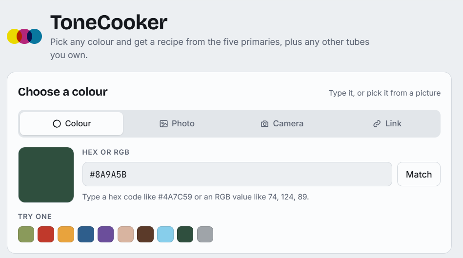
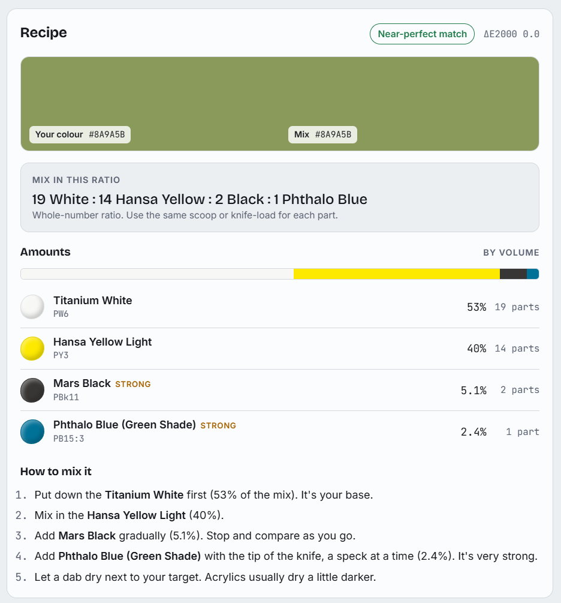
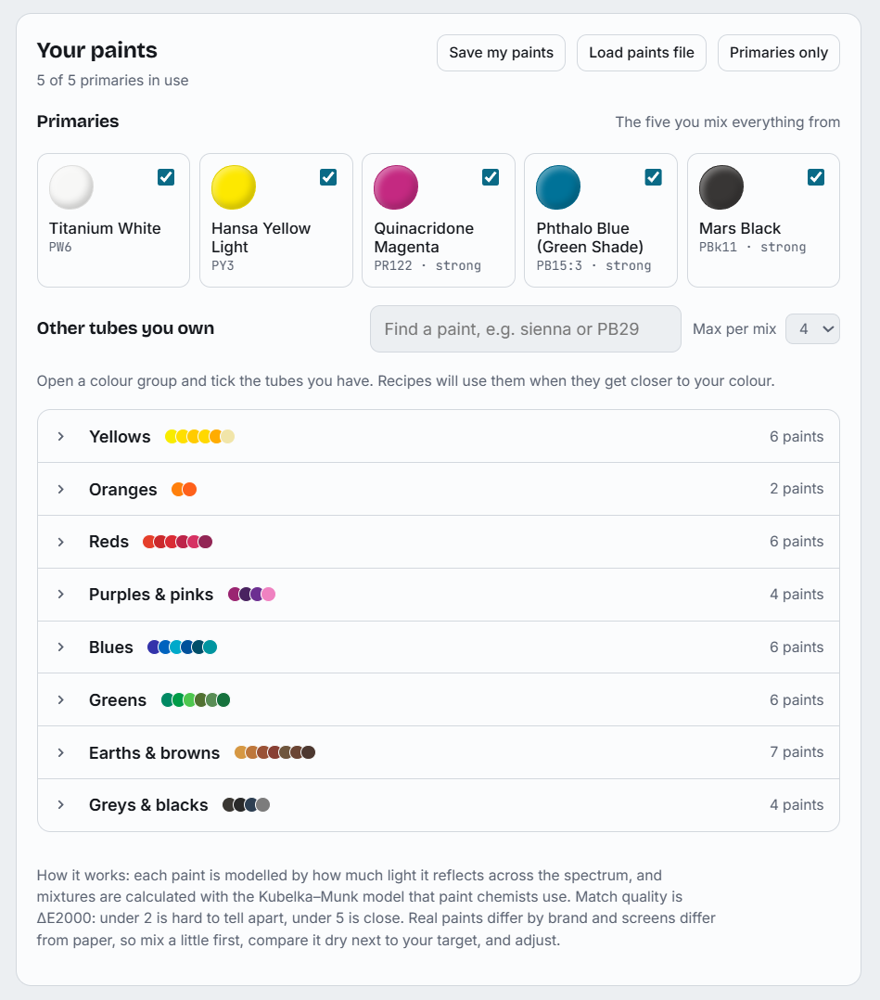

# ToneCooker

**Live: https://ezzyfezzy.github.io/tonecooker/**

Pick any colour — typed in, picked from a photo, or lifted from a link —
and get a real acrylic paint-mixing recipe built from five primaries,
plus any other tubes you own.

Mixtures are computed with the **Kubelka–Munk** spectral reflectance
model (the same math paint chemists use), and match quality is scored
with **CIEDE2000** (ΔE2000): under 2 is imperceptible, under 5 is close.

## Screenshots

| Choose a colour | Recipe | Your paints |
|---|---|---|
|  |  |  |

## Features

- **Four ways to pick a colour**: type a hex/RGB code, pick a pixel from
  a photo, shoot one with your camera, or load an image from a link.
- **White balance correction** when sampling from photos.
- **Whole-number mixing ratios** ("3 parts white : 2 parts yellow : …")
  plus a simpler alternative recipe when one exists.
- **Your own paint library**: tick the tubes you actually own, grouped
  by colour family, and recipes will use them when they get you closer.
- **Installable PWA**: works offline after the first load, installable
  to your home screen / app list.

## Getting started

```bash
npm install
npm run dev
```

Opens a dev server at `http://localhost:5173`.

```bash
npm run build      # production build → dist/
npm run preview    # serve the production build locally
```

### Running on your Tailscale network

Copy `.env.example` to `.env` and fill in your tailnet's hostname/IP:

```bash
cp .env.example .env
# TAILSCALE_HOSTNAME=your-machine.tailxxxxxx.ts.net
# TAILSCALE_IP=100.x.x.x
```

`npm run dev` / `npm run preview` then bind to all interfaces and
allow-list that host, so the app is reachable from any device on your
tailnet at `http://<TAILSCALE_IP>:5173`.

Note: browsers only offer the PWA install prompt over a secure context
(`https://` or `localhost`). Plain `http://` over Tailscale will work
fully as a web app, just without the install prompt — set up
`tailscale serve` for HTTPS if you want that too.

## Project structure

```
index.html          entry point
src/engine.js        colour-mixing engine (Kubelka–Munk + CIEDE2000)
src/app.js            UI wiring
src/style.css         styles
public/               PWA icons, favicon, manifest assets
assets/               source SVGs the icons are generated from
scripts/gen-icons.mjs  regenerates PNG icons from the SVG sources
vite.config.js         build + dev server + PWA (vite-plugin-pwa) config
```

## How it works

Each paint is modelled as a reflectance curve across the visible
spectrum. Mixing two or more paints is simulated with the Kubelka–Munk
scattering/absorption model, converted to Lab color space, and scored
against your target colour with CIEDE2000. The solver searches
combinations of your enabled paints (up to the "max per mix" you set)
for the closest match, then reduces the winning mix to a simple
whole-number ratio you can actually measure out.

Real paints vary by brand, and screens render colour differently from
paper — treat the recipe as a strong starting point, mix a small test
batch, let it dry, and adjust.

## License

[MIT](LICENSE)
